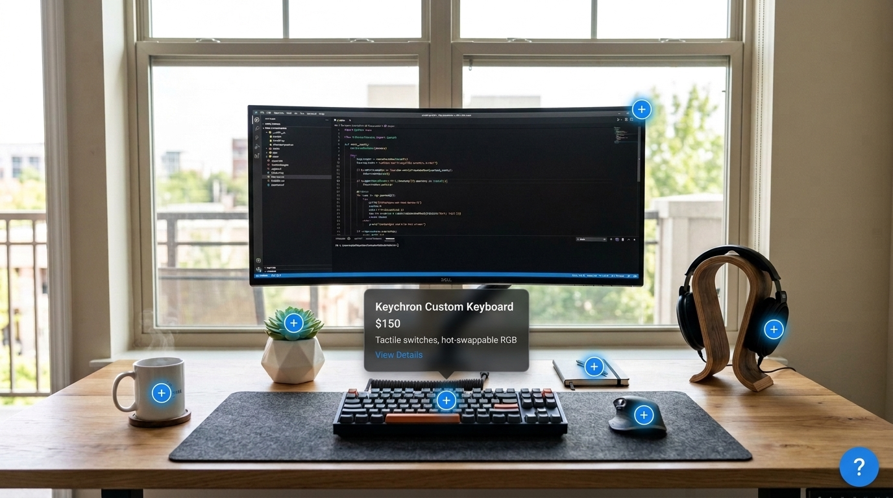
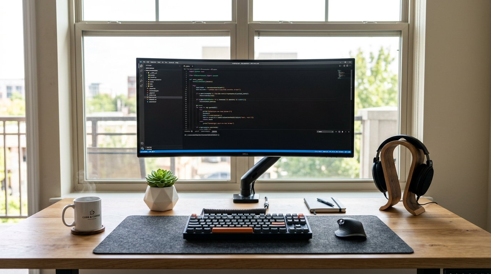

# დავალება 3 — ინტერაქციული Workspace Tour (CSS Positioning)

## მიზანი

პრაქტიკულად და სიღრმისეულად აითვისო CSS პოზიციონირების ოთხივე ძირითადი ინსტრუმენტი: `relative`, `absolute`, `fixed` და ფენების იერარქია `z-index`.

დავალების დასრულების შემდეგ ზუსტად გეცოდინება, როგორ განათავსო ელემენტები ერთმანეთის მიმართ პიქსელური თუ პროცენტული სიზუსტით და შექმნა ინტერაქციული UI კომპონენტები მხოლოდ HTML-ითა და CSS-ით.

---

## ვიზუალური რეფერენსი და რესურსები

ამ დავალებისთვის პროექტის `assets/` საქაღალდეში გამზადებული გაქვს ორი ფაილი:

### 1. საბოლოო შედეგის რეფერენსი (სამიზნე დიზაინი)
შენი მიზანია შექმნა ქვემოთ ნაჩვენები ინტერაქციული გვერდი:



### 2. სამუშაო ფოტო (რესურსი პროექტისთვის)
ფოტოს მოძიება არ დაგჭირდება — გამოიყენე პროექტში არსებული სუფთა სურათი: `assets/workspace-bg.jpg`:



---

## იდეა და კონტექსტი

წარმოიდგინე, რომ აწყობ **თანამედროვე პროდუქტის ტურს (Interactive Workspace Showcase)**:

გვერდზე გამოსახულია დეველოპერის სამუშაო მაგიდის სუფთა ფოტო (`workspace-bg.jpg`). მაგიდაზე არსებულ სხვადასხვა ნივთზე (მონიტორი, კლავიატურა, მაუსი, ყავის ჭიქა, მცენარე, ყურსასმენი, ბლოკნოტი) დასმულია პატარა მრგვალი წერტილები (Hotspots). როდესაც მომხმარებელი მაუსს მიიტანს რომელიმე წერტილზე, მის თავზე რბილად „ამოდის“ საინფორმაციო ბარათი (Tooltip) პროდუქტის დეტალებითა და ფასით. ეკრანის კუთხეში კი მუდმივად ჩანს მცურავი დამხმარე ვიჯეტი (`fixed`).

> **მნიშვნელოვანია:** დავალება სრულდება **მხოლოდ სუფთა HTML-ითა და CSS-ით** (JavaScript-ის გარეშე, ინტერაქცია მუშაობს `:hover`-ით).

---

## ძირითადი მოთხოვნები

- **სემანტიკური HTML:** გამოიყენე `<header>`, `<main>`, `<section>`, `<article>` და სხვა სემანტიკური ტეგები.
- **სუფთა CSS განლაგება:** გამოიყენე სწორი პოზიციონირება (`relative`, `absolute`, `fixed`) და თავი აარიდე გაუმართლებელ „ჯადოსნურ რიცხვებს“.
- **ფაილების ორგანიზება:** HTML და CSS დაწერე ცალ-ცალკე ფაილებში (`index.html` და `style.css`).

---

## დავალების ეტაპები (ნაბიჯ-ნაბიჯ)

### ნაწილი 1 — სცენა და საყრდენი წერტილი (`position: relative`)

1. შექმენი მთავარი კონტეინერი (მაგ. `.workspace-showcase`).
2. შიგნით განათავსე მოწოდებული სურათი (`assets/workspace-bg.jpg`).
3. **მთავარ კონტეინერს მიანიჭე `position: relative`.**
   * *რატომ?* ეს კონტეინერი ხდება „საყრდენი კედელი“ (საკოორდინატო სისტემა) ყველა იმ წერტილისთვის, რომელსაც შემდგომ შიგნით განათავსებ.

### ნაწილი 2 — Hotspot წერტილები (`position: absolute`)

1. მაგიდაზე არსებულ ნივთებზე განათავსე **Hotspot წერტილები** (`.hotspot`):
   - მონიტორი
   - კლავიატურა
   - მაუსი
   - ყავის ჭიქა
   - მცენარე
   - ყურსასმენი
   - ბლოკნოტი
2. თითოეულ წერტილს მიანიჭე `position: absolute`.
3. განალაგე წერტილები შესაბამის ნივთებზე **პროცენტული კოორდინატების** გამოყენებით (მაგ.: `top: 75%; left: 49%;` კლავიატურისთვის).
4. წერტილის იდეალურად გასაცენტრად კოორდინატთან მიმართებით გამოიყენე:
   ```css
   transform: translate(-50%, -50%);
   ```
5. მიეცი წერტილს ვიზუალი: მრგვალი ფორმა (`border-radius: 50%`), ჩრდილი / განათება და პატარა თეთრი `+` ნიშანი შუაში.

### ნაწილი 3 — საინფორმაციო ბარათი Tooltip (`position: absolute` + `:hover`)

1. `.hotspot` ელემენტის შიგნით (მინიმუმ კლავიატურაზე, სურვილის შემთხვევაში სხვებზეც) ჩასვი საინფორმაციო ბლოკი (`.tooltip`), სადაც ეწერება:
   - ნივთის დასახელება (მაგ. *Keychron Custom Keyboard*);
   - ფასი (*$150*);
   - მოკლე აღწერა (*Tactile switches, hot-swappable RGB*);
   - ბმული ან ღილაკი (*View Details*).
2. **Tooltip-ს მიანიჭე `position: absolute`.**
   * მისი საყრდენი თავად `.hotspot` წერტილია (რადგან ის მშობელია).
3. განათავსე Tooltip წერტილის ზემოთ:
   ```css
   bottom: 125%;
   left: 50%;
   transform: translateX(-50%);
   ```
4. **დამალვა და გამოჩენა:**
   - ჩვეულებრივ მდგომარეობაში Tooltip იყოს დამალული (`opacity: 0; visibility: hidden;`).
   - წერტილზე მაუსის მიტანისას ის რბილად გამოჩნდეს:
     ```css
     .hotspot:hover .tooltip {
       opacity: 1;
       visibility: visible;
     }
     ```
   - დაამატე `transition: all 0.3s ease;` გლუვი ანიმაციისთვის.

### ნაწილი 4 — ფენების მართვა (`z-index`)

1. დარწმუნდი, რომ Tooltip-ის გამოჩენისას ის არ იმალება მეზობელი ელემენტების ან სხვა წერტილების ქვეშ.
2. Tooltip-ს მიანიჭე შესაბამისი `z-index` (მაგ. `z-index: 10;`).

### ნაწილი 5 — მცურავი ვიჯეტი (`position: fixed`)

1. ეკრანის ქვედა მარჯვენა კუთხეში განათავსე მცურავი ღილაკი ან ვიჯეტი კითხვის ნიშნით: **`?`** (როგორც რეფერენსზეა).
2. გამოიყენე `position: fixed`, `bottom: 24px;` და `right: 24px;`.
3. შეამოწმე: გვერდის ჩამოსქროლვისას ეს ღილაკი მყარად უნდა დარჩეს ეკრანის კუთხეში.

---

## დამატებითი გამოწვევა (სურვილისამებრ)

თუ გსურს შენი ნამუშევარი კიდევ უფრო დახვეწილი იყოს:
- **პულსაციის ეფექტი:** წერტილებს გაუკეთე მუდმივი პულსირებადი ტალღის ეფექტი (`box-shadow`-ით ან `@keyframes pulse`-ით), რათა მნახველმა მარტივად შეამჩნიოს, რომ ისინი ინტერაქციულია.
- **ისარი Tooltip-ზე:** Tooltip-ის ქვედა მხარეს დაამატე პატარა სამკუთხედი ისარი (`::after` ფსევდოელემენტით), რომელიც წერტილისკენ მიუთითებს.

---

## ჩაბარების პირობები

- დავალება შესრულებულია მხოლოდ **სუფთა HTML და CSS**-ით.
- კოდი განაწილებულია ცალკე ფაილებში: `index.html` და `style.css`.
- კლასების სახელები არის ინგლისურ ენაზე, სემანტიკური და ლოგიკური (მაგ. `.workspace`, `.hotspot`, `.tooltip`, `.help-widget`).
- CSS კოდში კომენტარებით ახსენი, რატომ დასჭირდა მშობელს `relative` და შვილს `absolute`.
- დავალება გამოაგზავნე GitHub რეპოზიტორიის სახით, სადაც მითითებული იქნება პროექტის Live ლინკი (GitHub Pages).

---

## თვითშემოწმება

სანამ დავალებას ჩააბარებ, უპასუხე ამ კითხვებს:
1. რა მოუვიდოდა Hotspot წერტილებს, სურათის მშობელ კონტეინერს `position: relative` რომ არ ჰქონოდა?
2. რით განსხვავდება წერტილებისთვის გამოყენებული `absolute` ეკრანის კუთხეში მიმაგრებული `fixed` ღილაკისგან?
3. რა როლს ასრულებს `z-index` Tooltip-ის გამოჩენის დროს?
